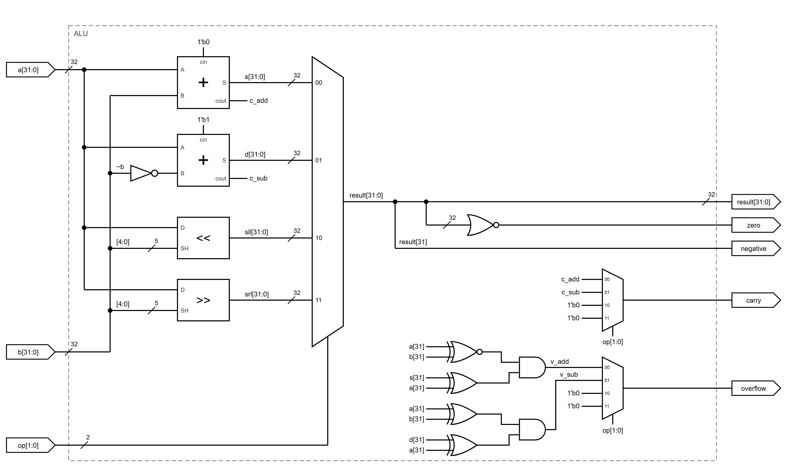

# 32-Bit ALU in Verilog

A 32-bit arithmetic logic unit written in Verilog that supports addition, subtraction, logical shift left, and logical shift right, with zero, negative, carry, and overflow flags. The design is verified with a self-checking testbench in Icarus Verilog, and the waveforms are viewed in GTKWave.



## Operations

| `op` | Operation | Result |
|------|-----------|--------|
| `00` | ADD | `a + b` |
| `01` | SUB | `a - b` |
| `10` | SLL | `a << b[4:0]` |
| `11` | SRL | `a >> b[4:0]` |

## Status Flags

| Flag | Meaning |
|------|---------|
| `zero` | Result is 0 |
| `negative` | Result bit 31 is set |
| `carry` | Carry out of bit 31 (ADD and SUB only). For SUB, 1 means no borrow. |
| `overflow` | Signed two's complement overflow (ADD and SUB only) |

## Design Notes

- All four operations are computed in parallel and a 4:1 mux selects the result based on `op`.
- The adder and subtractor are 33 bits wide so the carry out lands in bit 32.
- Subtraction is done as `a + ~b + 1` (two's complement).
- Overflow is detected from the sign bits:
  - ADD: `a` and `b` have the same sign, but the result's sign is different.
  - SUB: `a` and `b` have different signs, and the result's sign is different from `a`.
- Only `b[4:0]` is used as the shift amount, so shifting by 33 is the same as shifting by 1.
- Every output gets a default value at the top of the `always @(*)` block so no latches are inferred.

## Verification

The testbench in `ALU_tb.v` runs 17 test cases through a `check` task that compares the result and all four flags against expected values and prints PASS or FAIL. The tests cover normal values plus edge cases: unsigned carry out, signed overflow in both directions, zero results, shifting by 0 and by 31, and a shift amount above 31.

**All 17 tests pass.**


## Running It

Requires [Icarus Verilog](https://steveicarus.github.io/iverilog/) and [GTKWave](https://gtkwave.sourceforge.net/).

```
iverilog -o alu_sim ALU.v ALU_tb.v
vvp alu_sim
gtkwave ALU_tb.vcd ALU_tb.gtkw
```

On Windows, `run_sim.ps1` runs all three steps.

## Files

| File | Description |
|------|-------------|
| `ALU.v` | ALU design |
| `ALU_tb.v` | Self-checking testbench |
| `ALU_tb.gtkw` | GTKWave signal layout |
| `ALU_Report.pdf` | Full design and verification report |

## Future Work

- Add arithmetic shift right, AND, OR, XOR, and set-less-than
- Randomized testing against a reference model
- Run the design on an FPGA board
- Use the ALU as the core of a simple RISC-V CPU

**Levi Herndon** · Electrical Engineering, Colorado School of Mines · [LinkedIn](https://www.linkedin.com/in/levi-herndon/)
